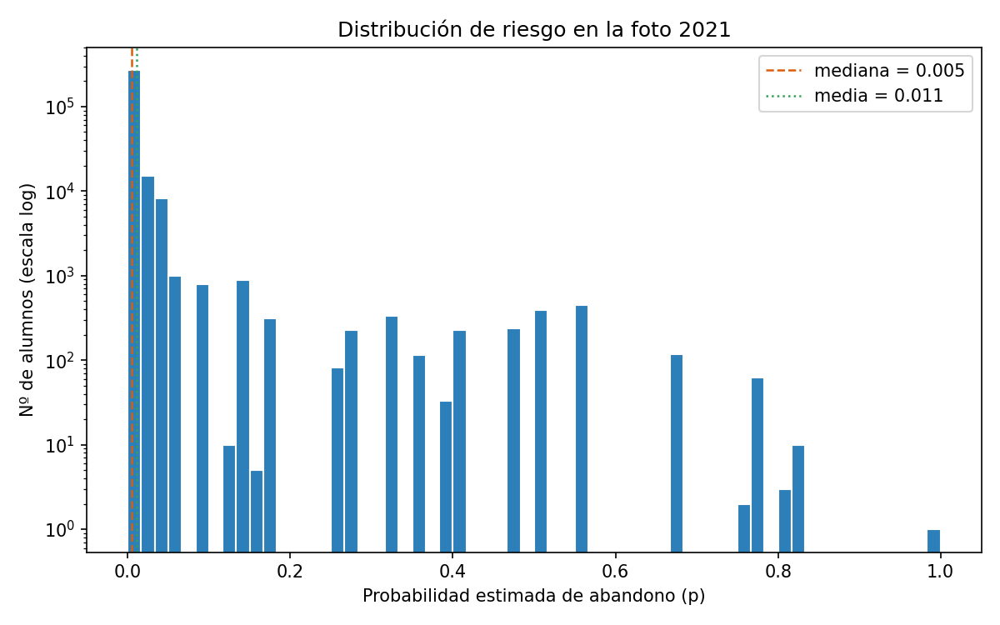
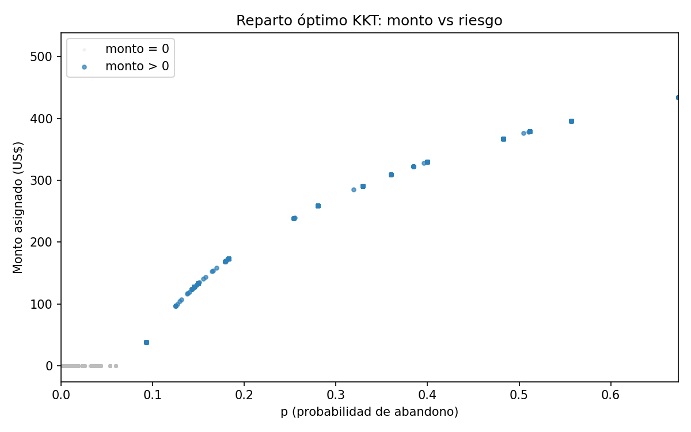
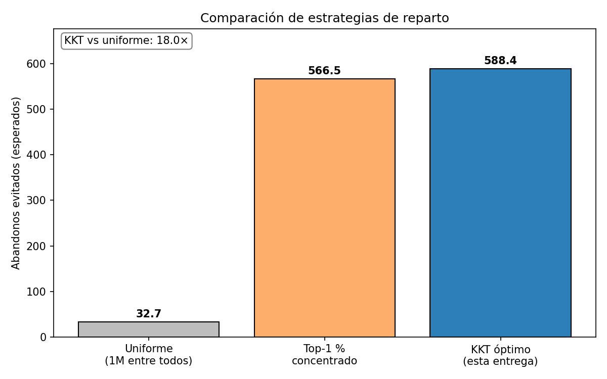

marp: true
theme: default
paginate: true
---

# US$1.000.000 contra el abandono escolar

**Equipo:** Lavia, Ram, Salazar, Stipisich
**Curso:** Aplicación de Ciencia de Datos
**Fecha:** noviembre 2026

---

## El problema

- Presupuesto: **US$ 1.000.000** para repartir entre los alumnos de la foto 2021.
- Objetivo: **minimizar abandonos en 2022**.
- Restricciones: montos ≥ 0, suma ≤ 1.000.000, una fila por alumno.
- Rendimiento: `efecto(m) = 0,6 · (1 − e^(−m/200))` — cóncavo, satura en 60 %.

---

## Pipeline en 4 pasos

1. **Modelo de riesgo**: LightGBM sobre fotos 2019–2020, etiqueta `abandono_t1`.
2. **Predicción**: `p_abandono` para 298.173 alumnos de 2021.
3. **Optimización**: KKT sobre `Σ p_i · 0,6 · (1 − e^(−m_i/200))`.
4. **Entrega**: `entrega.csv` validado.

---

## Modelo de riesgo

- Split temporal: entrena **2019**, valida **2020** (sin fuga).
- Features: promedio, asistencia, edad, repetición, cambios de escuela, agregados de
  escuela, dependencia, ruralidad, región, enseñanza, grado, jornada, género, `sit_fin`.
- **AUC val 2020: 0,8424** · **Brier calibrado: 0,00965**
- Predicción 2021: `p` media 1,10 %, mediana 0,46 %, máximo 1,0.

---

## La idea clave: KKT

Maximizar `Σ p_i · 0,6 · (1 − e^(−m_i/200))` sujeto a `Σ m_i ≤ 1.000.000`.

Por KKT, todos los que reciben tienen el **mismo retorno marginal λ**:
m_i = 200 · ln( p_i · 0,6 / (200·λ) ) si positivo
m_i = 0 si no

Calibramos λ por bisección hasta que la suma dé 1.000.000.

---

## Resultado del reparto

- **λ = 2,308·10⁻⁴**
- **4.306 alumnos** reciben plata (1,4 % de la foto)
- Monto mínimo: US$ 38,07 · mediana: US$ 258,55 · máximo: US$ 512,96
- **Suma exacta: US$ 1.000.000,00**

---

## KKT vs otras estrategias

 estrategia  alumnos_con_plata  monto_por_alumno_mediana  ganancia  ratio_vs_kkt
  KKT óptimo (entrega)               4306                    258.55    588.37         1.000
  Top-1 % concentrado               2982                    335.35    566.49         0.963
  Top-2 % concentrado               5963                    167.70    475.48         0.808
  Top-0.5 % concentrado               1491                    670.69    459.52         0.781
  Top-5 % concentrado              14909                     67.07    296.06         0.503
  Top-10 % concentrado              29817                     33.54    190.90         0.324
  Top-20 % concentrado              59635                     16.77    117.46         0.200
 Uniforme entre todos             298173                      3.35     32.68         0.056

- KKT le gana al **uniforme por ~18×**.
- KKT le gana al **top-1 % por ~4 %** (concentrar satura el efecto).
- El óptimo es **intermedio**: pocos alumnos, montos moderados.

---

## Las tres preguntas del enunciado

**¿Alcanza con ordenar?** No: importa el orden *y* el monto; el KKT le gana al top-1 %.

**¿Poco a muchos o mucho a pocos?** Intermedio: 4.306 alumnos, mediana US$ 258.

**¿Es razonable la hipótesis causal?** Es fuerte; validarla requiere diseño causal
(experimento, RD, diff-in-diff). El modelo solo estima `p`.

---

## Limitaciones y aprendizajes

- La hipótesis causal es la parte frágil: si el programa no funciona, el óptimo cambia.
- `is_unbalance=True` estancaba el modelo; sacarlo subió el AUC a 0,842.
- La calibración isotónica es clave: sin ella el KKT reparte mal.
- Próximo paso: validar el efecto con un diseño causal, no solo con el modelo.

---

## Gracias

**Repo:** `solucion/`
**Entrega:** `solucion/entrega.csv`
**Preguntas:** [completar]